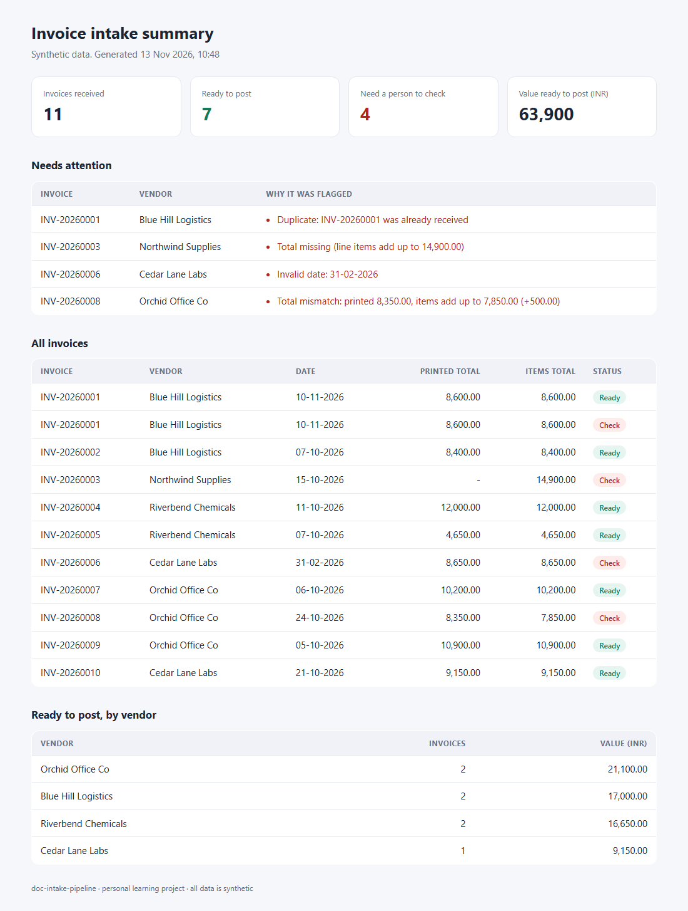
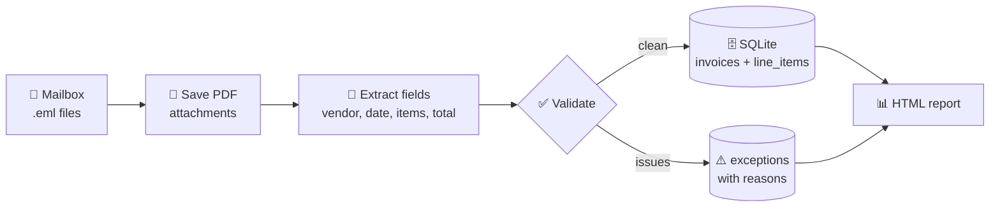

# doc-intake-pipeline

[](https://github.com/builtbyshailendra/doc-intake-pipeline/actions/workflows/tests.yml)


**Emailed PDF invoices in, clean SQL rows and a one-page report out. Anything that doesn't add up is flagged for a person, with the reason in plain words.**

> Personal learning project. Every company, person and amount here is made up.



## Why

Plenty of teams still have someone opening emailed PDFs and typing the numbers into a spreadsheet. Reading the PDF is the easy part. The real work is deciding what counts as an exception, and making the result easy for the finance team to trust.

## How it works



| Step | File | What it does |
|---|---|---|
| Mailbox | [`mailbox.py`](src/doc_intake/mailbox.py) | Reads `.eml` files with Python's `email` module and saves each PDF attachment |
| Extract | [`extract.py`](src/doc_intake/extract.py) | Reads the PDF text and pulls out invoice number, date, vendor, line items and printed total. It never "fixes" anything |
| Validate | [`validate.py`](src/doc_intake/validate.py) | Flags duplicates, impossible dates, missing totals and totals that don't match the line items |
| Store | [`store.py`](src/doc_intake/store.py) | Writes three tables: `invoices`, `line_items`, `exceptions` |
| Report | [`report.py`](src/doc_intake/report.py) | One self-contained HTML page: counts, what needs attention and why, totals by vendor |

## What it catches

The demo mailbox has 11 emails. Four need a person, and each one is a mistake that turns up in real inboxes:

| Problem | Example reason in the report |
|---|---|
| Same invoice sent twice | `Duplicate: INV-20260001 was already received` |
| No total printed | `Total missing (line items add up to 14,900.00)` |
| Date that can't exist | `Invalid date: 31-02-2026` |
| Total doesn't match the lines | `Total mismatch: printed 8,350.00, items add up to 7,850.00 (+500.00)` |

## Run it

```bash
pip install -r requirements.txt
cd src
python -m doc_intake demo --data ../data --db ../data/invoices.db --report ../reports/summary.html
```

```text
Processed 11 attachments: 7 ready, 4 flagged.
```

Then open `reports/summary.html`, or query the database:

```sql
SELECT i.invoice_no, e.reason
FROM exceptions e JOIN invoices i ON i.id = e.invoice_id;
```

Tests (also run by GitHub Actions on every push):

```bash
pytest -q
```

The tests check the extractor against an answer key written by the generator, each validation rule on its own, and the whole run end to end.

## Build log

Built on 13 November 2026, one step at a time.

### Step 1: synthetic invoices

**Built:** a generator for 10 invoice PDFs with a fixed seed, so every run is identical. Three are broken on purpose: no total, a 31 February date, and a total 500 higher than its lines. An `answer_key.json` records what each PDF really contains.

**Decision:** keep the invoice date as text. A Python date can't hold 31 February, but a PDF can, and the pipeline must catch it rather than crash.

### Step 2: mailbox and extraction

**Built:** each PDF wrapped in an email, a reader that saves attachments, and an extractor that turns PDF text into fields and line items.

**Learned:** the PDF text comes out one cell per line, so a line item is four lines in a row: description, quantity, unit price, amount. The extractor reads them in fours between the column header and the total.

### Step 3: validation, database and report

**Built:** four rules, three SQLite tables and the HTML report. A reminder email that resends invoice 1 shows how duplicates arrive.

**What broke:** the number columns' headers sat left-aligned above right-aligned numbers, because the CSS rule only targeted table cells, not headers. One selector fixed it.

## Next

- Read from a real IMAP mailbox (credentials from environment variables, never in code)
- Handle a second invoice layout from a different vendor
- Run on a schedule and email the report
